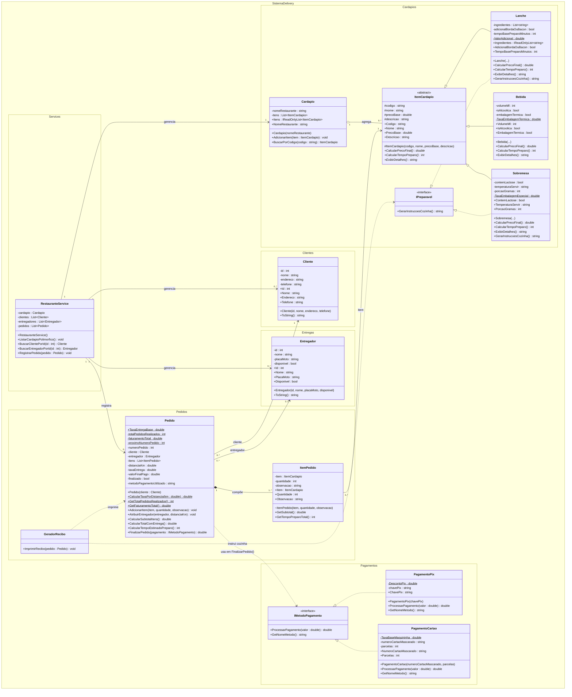

# Diagrama de Classes UML — Sistema de Pedidos / Delivery

Diagrama fiel ao código-fonte atual em `C:\git\Ask` (organizado por *Feature Folders* e namespaces `SistemaDelivery.*`).

---

## Legenda dos Relacionamentos e Requisitos de POO

| Símbolo UML | Relacionamento | Onde ocorre no código |
| :---: | :--- | :--- |
| `<\|--` | **Herança** | `Lanche`, `Bebida` e `Sobremesa` herdam de `ItemCardapio` |
| `<\|..` | **Realização (Interface)** | `Lanche` e `Sobremesa` implementam `IPreparavel`; `PagamentoPix` e `PagamentoCartao` implementam `IMetodoPagamento` |
| `*--` | **Composição** | `Pedido` cria e gerencia `ItemPedido` internamente (`construtor internal`) |
| `o--` | **Agregação** | `Cardapio` agrega instâncias de `ItemCardapio` criadas externamente |
| `-->` | **Associação Simples** | `Pedido` referencia `Cliente` e `Entregador`; `ItemPedido` referencia `ItemCardapio`; `RestauranteService` gerencia entidades |
| `..>` | **Dependência** | `Pedido.FinalizarPedido(IMetodoPagamento)` e `GeradorRecibo.ImprimirRecibo(Pedido)` |
